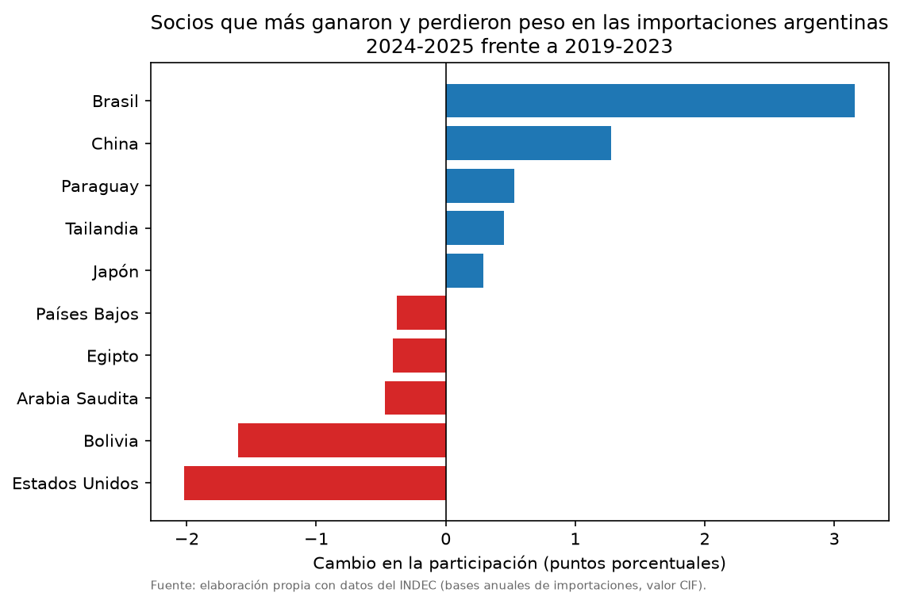

# Socios comerciales de Argentina: ¿quién ganó peso en las importaciones con el cambio de régimen frente al mercado externo?

**Autora:** Renata Morri · **Curso:** Herramientas computacionales para Economistas, UNLP · **Fecha:** noviembre de 2026

## Pregunta
¿Qué socios comerciales ganaron (o perdieron) participación en las importaciones argentinas desde 2024, en comparación con 2019–2023?

- **Unidad de análisis:** país socio (país de origen de las importaciones) por año.
- **Período:** 2019–2025.
- **Por qué importa:** desde 2024 cambió la política hacia el comercio exterior, con menos restricciones a las importaciones. Ver qué socios ganaron o perdieron peso ayuda a entender a qué mercados se abrió la economía argentina. Es un punto de partida para lo que me gustaría investigar en mi tesis, sobre todo el efecto en mercados más específicos.

## Fuentes
| Fuente | Quién la produce | URL | Fecha de descarga | Licencia o condiciones | Cómo se obtiene |
| --- | --- | --- | --- | --- | --- |
| Bases anuales de importaciones 2019–2025 | INDEC | `https://comex.indec.gob.ar/files/zips/imports_{año}_Y.zip` | 04/11/2026 | Datos públicos del INDEC; se cita la fuente | Descarga con `requests` (`01_obtencion.ipynb`) |
| Nomenclador de países | INDEC | https://comex.indec.gob.ar/#/ (pestaña Nomencladores) | 02/11/2026 | Datos públicos del INDEC; se cita la fuente | Descarga manual: el sitio genera el archivo en el navegador y no ofrece un link directo |
| Mapa de países del mundo (escala 1:110m) | Natural Earth | https://raw.githubusercontent.com/nvkelso/natural-earth-vector/master/geojson/ne_110m_admin_0_countries.geojson | 04/11/2026 | Dominio público | Descarga con `requests` (`01_obtencion.ipynb`) |

**Qué contiene cada fuente:**
- **Bases de importaciones:** un zip por año con el valor importado por producto (NCM a 8 dígitos) y país de origen, en kilos y en dólares (FOB, flete, seguro y CIF). Incluye un archivo de control (`itota`) con la cantidad de registros y los totales, y un `Leame` con la descripción de las columnas.
- **Nomenclador de países:** el código de país del INDEC, el código ISO de dos letras y el nombre.
- **Mapa:** la geometría de cada país, con sus códigos ISO.

## Cómo ejecutar
1. Crear el entorno: `python -m venv .venv` e instalar con `pip install -r requirements.txt`.
2. No hace falta clave de API.
3. En `config.py`, dejar `MODO_MUESTRA = True` para una corrida rápida con un solo año (unos [N] minutos) o `False` para todo el período (unos [N] minutos).
4. Ejecutar en orden: `01_obtencion.ipynb`, `02_limpieza.ipynb`, `03_analisis.ipynb`.

## Estructura
- `config.py`: rutas, años a analizar y `MODO_MUESTRA`.
- `01_obtencion.ipynb`: descarga las bases del INDEC y el mapa, y descomprime los zips.
- `02_limpieza.ipynb`: lectura, verificación contra los totales del INDEC, expresiones regulares y unión con el nomenclador y el mapa.
- `03_analisis.ipynb`: gráficos, mapas y conclusiones.
- `datos/crudo/`: lo descargado tal cual (zips del INDEC y nomenclador). Las carpetas descomprimidas no se suben: se regeneran con `01_obtencion.ipynb`.
- `datos/geo/`: el mapa de países.
- `datos/procesado/`: las bases finales.
- `figuras/`: gráficos y mapas guardados.

## Principales resultados
Entre 2019–2023 y 2024–2025, Brasil (+3,2 puntos) y China (+1,3) fueron los socios que más ganaron peso en las importaciones argentinas: entre los dos pasaron de 41,8% a 46,3% del total. Estados Unidos (−2,0) y Bolivia (−1,6) fueron los que más perdieron. El gráfico anual muestra que no todos los cambios empiezan en 2024: Brasil sube en 2023 y China recién en 2025.

## Qué verifiqué y qué no
- La cantidad de filas y el total CIF de cada año coinciden con los archivos de control del INDEC.
- Los nombres de las columnas cambian entre 2021 (u$s) y 2022 (USD); los unifiqué con código.
- No hay filas repetidas ni montos negativos; todos los códigos de país están en el nomenclador; los códigos NCM tienen 8 dígitos.
- Los merges no agregan ni pierden filas, y las participaciones suman 100%.
- No pude verificar si los cambios vienen de precios o de cantidades, ni sus causas. Entre 0,9% y 1,6% de cada año no tiene país asignado. El detalle está en `03_analisis.ipynb`.

## Bitácora de uso de IA
Use claude para que me ayude con lógicas, errores de sintaxis. Me sirve que me ayude a ordenar la idea y cual es la iteración de pasos a seguir. Además la use para embellecer gráficos y mejorar redacción.

**Un caso en que la IA se equivocó:** ninguno puntual.
